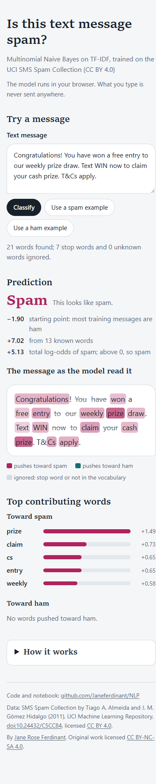
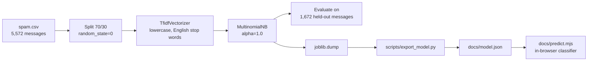

# SMS Spam Classifier: TF-IDF and Naive Bayes that flags spam text messages

[](https://creativecommons.org/licenses/by-nc-nd/4.0/)
[](https://colab.research.google.com/github/Janeferdinant/NLP/blob/main/spam_ham.ipynb)

## Overview

A scikit-learn notebook that trains a Multinomial Naive Bayes classifier on TF-IDF features to separate spam from ordinary ("ham") text messages. It uses the public UCI SMS Spam Collection and is small enough to read in one sitting, so it works as a teaching example of a complete text-classification pipeline: explore, vectorize, train, evaluate. The repository also contains an in-browser version of the trained model that runs without a server.

## Demo

An in-browser demo is included in [`docs/`](docs/). It shows the prediction for any message you type, one spam and one ham example, and the words that pushed the decision. A "How it works" panel explains each step. The page is ready for GitHub Pages, but Pages is not enabled on this repository, so there is no hosted link yet. To run it locally:

```bash
python -m http.server -d docs
```

Then open http://localhost:8000. (On Windows, if the page stays on "Loading the model", your Python may serve `.mjs` files as plain text; use `npx serve docs` instead.)



The page does not show an accuracy figure. The measured results are in [Results](#results).

## Problem statement

Unwanted text messages waste time and are often scams. Given the text of a message, decide whether it is spam. The classes are imbalanced (13% spam), so accuracy alone is misleading, and this repository reports precision, recall and F1 next to it.

## Approach



1. **Explore.** Class counts, spam and ham word clouds.
2. **Vectorize.** `TfidfVectorizer(lowercase=True, stop_words='english')` fitted on the training split only. It produces 6,839 features (unigrams, default token pattern, L2 norm, smoothed idf).
3. **Train.** `MultinomialNB()` with default settings (`alpha=1.0`, priors learned from the data).
4. **Evaluate.** Accuracy, confusion matrix, precision, recall and F1 on the held-out messages.
5. **Export.** The last notebook cell saves the fitted vectorizer and model with `joblib`. `scripts/export_model.py` converts them to `docs/model.json` (vocabulary, idf, stop words, parameters, class priors and word log-probabilities).
6. **Run in the browser.** `docs/predict.mjs` re-implements the pipeline in JavaScript. `docs/parity.test.mjs` checks that it predicts exactly what scikit-learn predicts on every held-out message.

## Data

- **Source:** SMS Spam Collection by Tiago A. Almeida and José María Gómez Hidalgo, UCI Machine Learning Repository, https://doi.org/10.24432/C5CC84.
- **License:** Creative Commons Attribution 4.0 (CC BY 4.0). See [`THIRD_PARTY_NOTICES.md`](THIRD_PARTY_NOTICES.md).
- **Size:** `spam.csv` has 5,572 messages (4,825 ham, 747 spam). The UCI release lists 5,574, so this copy is slightly smaller.
- **Split:** `train_test_split(test_size=0.3, random_state=0)`, no stratification: 3,900 training and 1,672 test messages (1,434 ham, 238 spam).
- **Encoding:** the file is not valid UTF-8 and is read as ISO-8859-1, which turns some characters into 36 "mojibake" vocabulary tokens.
- **Privacy:** the messages are public research data. They include phone numbers and shortcodes typical of spam.

## Results

Measured on the 1,672 held-out messages; spam is the positive class. All values come from the re-run logged in [`docs/runs/2026-10-13-rerun.md`](docs/runs/2026-10-13-rerun.md) (Python 3.11.9, scikit-learn 1.9.1).

| Metric | Value | Status | How measured | Date |
|---|---|---|---|---|
| Accuracy | 96.41% | Verified (re-run 2026-10-13) | `classifier.score` on the test split | 2026-10-13 |
| Precision (spam) | 1.00 | Verified (re-run 2026-10-13) | `classification_report` | 2026-10-13 |
| Recall (spam) | 0.75 | Verified (re-run 2026-10-13) | `classification_report` | 2026-10-13 |
| F1 (spam) | 0.86 | Verified (re-run 2026-10-13) | `classification_report` | 2026-10-13 |
| Majority-class baseline accuracy (always predict ham) | 85.77% | Verified (re-run 2026-10-13) | 1,434 of 1,672 | 2026-10-13 |
| JavaScript vs scikit-learn predictions | 0 mismatches in 1,672 | Verified (re-run 2026-10-13) | `node --test docs/parity.test.mjs` | 2026-10-13 |

Confusion matrix (rows: actual ham, spam; columns: predicted ham, spam): `[[1434, 0], [60, 178]]`. The model never flagged a normal message as spam on this split, but it missed 60 of the 238 spam messages (about 1 in 4). The 96.41% accuracy is 10.6 points above the majority baseline.

## Tech stack

Python 3.11, pandas, NumPy, scikit-learn, joblib, Matplotlib, WordCloud, Jupyter. The demo is plain HTML and JavaScript with no dependencies; the parity test uses `node --test` (Node.js 18 or later).

## Getting started

Prerequisites: Python 3.11 or later (verified on 3.11.9) and, for the demo test, Node.js 18 or later (verified on 22.20).

```bash
git clone https://github.com/Janeferdinant/NLP.git
cd NLP
python -m venv .venv
source .venv/bin/activate        # Windows: .venv\Scripts\activate
pip install -r requirements.txt
jupyter nbconvert --to notebook --execute --inplace spam_ham.ipynb
python scripts/export_model.py
node --test docs/parity.test.mjs
```

Expected output: the notebook run takes about 15 seconds and prints `classifier accuracy 96.41%`. The export script prints `vocabulary size: 6839` and the metrics above. The test ends with `# pass 2` and `# fail 0`. Note that `--inplace` refreshes the outputs stored in `spam_ham.ipynb`. To open the notebook interactively, run `jupyter lab` or use the Colab badge above.

## Project structure

```
spam_ham.ipynb            the full pipeline (explore, vectorize, train, evaluate, save)
spam.csv                  UCI SMS Spam Collection (CC BY 4.0)
requirements.txt          pinned versions from the verified run
scripts/export_model.py   joblib files -> docs/model.json and docs/fixtures.json
docs/index.html           in-browser demo
docs/predict.mjs          JavaScript re-implementation of TF-IDF + Naive Bayes
docs/parity.test.mjs      checks the JavaScript against scikit-learn on 1,672 messages
docs/model.json           exported model parameters
docs/fixtures.json        the 1,672 test messages with scikit-learn's predictions
docs/runs/                dated run logs
THIRD_PARTY_NOTICES.md    dataset and third-party attributions
LICENSE                   CC BY-NC-ND 4.0
```

The repository also holds older files that are unrelated to this project (17 JPEG images, `stylesheet.css`, `spam-ham.pdf` and a GitHub Pages workflow). They are listed for removal in the pull request that added this README and are not part of the project.

## Real-world applications

- Filtering unwanted SMS or chat messages before they reach a person.
- A baseline that more complex models (logistic regression, transformers) should beat before they are adopted.
- A classroom example for text preprocessing, TF-IDF, Naive Bayes and imbalanced-class metrics.

## Limitations

- The model misses about 1 in 4 spam messages on held-out data. A real filter would need a better recall.
- Training and test messages come from the same corpus, which largely comes from UK and Singapore sources and was published in 2011. Spam today looks different, and messages in other languages or styles will be classified poorly.
- Naive Bayes ignores word order and context, and ignores any word not in the 6,839-word vocabulary.
- The split is a single random split with no cross-validation and no confidence interval, so the figures above have no stated uncertainty.
- The vectorizer is fitted on the training split only, but the hyperparameters were not tuned and the project has no validation set.

## Future scope

- Stratified splits and cross-validation with confidence intervals.
- Compare against logistic regression and a small transformer on the same split.
- Tune the decision threshold to trade recall against false positives.
- Add character n-grams and features such as message length and digit count.

## Credits & citation

- Dataset: Almeida, T. & Hidalgo, J. (2011). SMS Spam Collection [Dataset]. UCI Machine Learning Repository. https://doi.org/10.24432/C5CC84 (CC BY 4.0).
- Dataset paper: Almeida, T. A., Gómez Hidalgo, J. M. and Yamakami, A. (2011). Contributions to the study of SMS spam filtering: new collection and results. ACM DocEng. https://doi.org/10.1145/2034691.2034742
- Related reading: Şahin, E., Aydos, M. and Orhan, F. (2018). Spam/Ham E-Mail Classification using Machine Learning Methods based on Bag of Words Technique. SIU 2018. https://doi.org/10.1109/SIU.2018.8404347 (IEEE; cited, not redistributed).
- Libraries: scikit-learn, pandas, NumPy, Matplotlib, WordCloud.

## License

Original work © Jane Rose Ferdinant, licensed CC BY-NC-ND 4.0. Third-party components retain their own licenses; see THIRD_PARTY_NOTICES.md.

## Author

Jane Rose Ferdinant, [portfolio](https://janeferdinant.vercel.app) · [LinkedIn](https://www.linkedin.com/in/janerosenf/)
