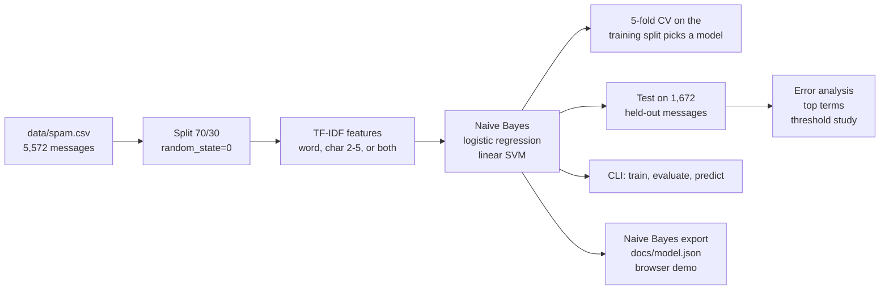
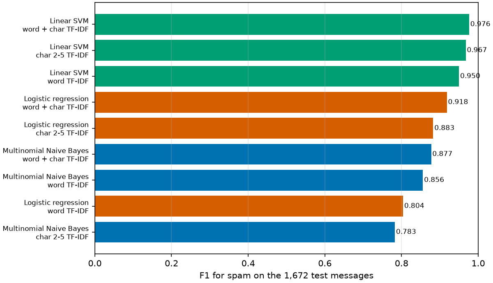

# SMS Spam Classifier: comparing Naive Bayes, logistic regression and a linear SVM on text messages

<p align="center">
  
</p>

[](https://creativecommons.org/licenses/by-nc-nd/4.0/)
[](https://colab.research.google.com/github/Janeferdinant/NLP/blob/main/notebooks/spam_ham.ipynb)
[](https://janeferdinant.github.io/NLP/)

## Overview

A small natural-language-processing project that decides whether a text message is spam. It started as one notebook (TF-IDF features and Multinomial Naive Bayes, 96.41% accuracy) and is now a Python package with a command-line tool, tests, a model comparison, an error analysis and an in-browser demo. On the same held-out messages, a linear SVM on word and character TF-IDF features misses 11 of 238 spam messages where the notebook's model missed 60, with no ham message flagged by either (run 2026-10-14, see [Results](#results)).

The banner image is decorative artwork from the repository's earlier life. It was not produced by any model here.

## Demo

A browser demo runs the **Naive Bayes baseline** from the notebook, entirely client-side: [janeferdinant.github.io/NLP](https://janeferdinant.github.io/NLP/). It shows the prediction for any message you type, one spam and one ham example, and the words that pushed the decision. It is not the best model of this repository (see [Limitations](#limitations)); the best model needs character n-gram features that the demo's JavaScript does not implement. To run it locally:

```bash
python -m http.server -d docs
```

Then open http://localhost:8000. (On Windows, if the page stays on "Loading the model", your Python may serve `.mjs` files as plain text; use `npx serve docs` instead.)


The page does not show an accuracy figure. The measured results are below.

## Problem statement

Unwanted text messages waste time and are often scams. Given the text of a message, decide whether it is spam. Only 13% of the messages are spam, so accuracy alone is misleading (always answering "ham" is already 85.77% accurate). This project reports precision, recall and F1 for the spam class, and studies the trade-off between the two when the decision threshold moves.

## Approach



1. **Load and split.** `spam_classifier.data` reads `data/spam.csv` and splits it exactly as the notebook does (`test_size=0.3`, `random_state=0`, no stratification): 3,900 training and 1,672 test messages.
2. **Features.** `spam_classifier.features` builds TF-IDF vectors from words (the notebook's settings: lowercase, English stop words, unigrams, 6,839 features), from characters (`char_wb`, 2 to 5 characters, 33,460 features), or from both (40,299 features). `spam_classifier.preprocessing` offers an optional normalisation that replaces links, prices and long numbers by tokens.
3. **Models.** `spam_classifier.models` wraps each of Multinomial Naive Bayes, logistic regression and a linear SVM (scikit-learn defaults, nothing tuned) with its vectorizer in one pipeline.
4. **Evaluate.** `spam_classifier.evaluation` computes metrics, a bootstrap interval for accuracy, 5-fold cross-validation, precision-recall curves, threshold sweeps, the strongest terms and the error lists. The best model is picked by cross-validated F1 on the **training** split only; the test split is used once per model to report.
5. **Use.** `python -m spam_classifier train | evaluate | predict`, with the saved model in `model/` (git-ignored).
6. **Demo.** `scripts/export_model.py` trains the Naive Bayes baseline and exports it to `docs/model.json`; `docs/predict.mjs` re-implements it in JavaScript and `docs/parity.test.mjs` checks that it matches scikit-learn on all 1,672 test messages.

## Data

- **Source:** SMS Spam Collection by Tiago A. Almeida and José María Gómez Hidalgo, UCI Machine Learning Repository, https://doi.org/10.24432/C5CC84.
- **License:** Creative Commons Attribution 4.0 (CC BY 4.0). See [`THIRD_PARTY_NOTICES.md`](THIRD_PARTY_NOTICES.md).
- **Size:** `data/spam.csv` has 5,572 messages (4,825 ham, 747 spam). The UCI release lists 5,574, so this copy is slightly smaller.
- **Split:** 3,900 training and 1,672 test messages (1,434 ham, 238 spam).
- **Encoding:** the file is not valid UTF-8 and is read as ISO-8859-1, so characters such as the pound sign appear as artefacts (for example `å£`).
- **Privacy:** the messages are public research data. They include phone numbers and shortcodes typical of spam. The error analysis quotes messages from this file, replaces digit runs of 7 or more digits by `[number]` and cuts each message at 160 characters.

## Results

All numbers below are **Verified (run 2026-10-14)**: produced by `python -m spam_classifier evaluate --compare` (Python 3.11.9, scikit-learn 1.9.1) and logged in [`docs/runs/2026-10-14-model-comparison.md`](docs/runs/2026-10-14-model-comparison.md). They are new numbers from a new run; the Naive Bayes + word row reproduces the notebook's 96.41% (also logged in [`docs/runs/2026-10-13-rerun.md`](docs/runs/2026-10-13-rerun.md)). Measured on the 1,672 held-out messages, spam is the positive class, and the rows are ordered by 5-fold cross-validated F1 on the training split.

| Model | Features | Accuracy (95% bootstrap CI) | Precision | Recall | F1 | False positives | False negatives | Status |
|---|---|---|---|---|---|---|---|---|
| Linear SVM | word + char | 99.34% (98.92 to 99.70) | 1.0000 | 0.9538 | 0.9763 | 0 | 11 | Verified (run 2026-10-14) |
| Linear SVM | char 2-5 | 99.10% (98.62 to 99.52) | 1.0000 | 0.9370 | 0.9675 | 0 | 15 | Verified (run 2026-10-14) |
| Linear SVM | word | 98.62% (98.02 to 99.16) | 0.9864 | 0.9160 | 0.9499 | 3 | 20 | Verified (run 2026-10-14) |
| Logistic regression | word + char | 97.85% (97.13 to 98.50) | 1.0000 | 0.8487 | 0.9182 | 0 | 36 | Verified (run 2026-10-14) |
| Logistic regression | char 2-5 | 97.01% (96.17 to 97.79) | 1.0000 | 0.7899 | 0.8826 | 0 | 50 | Verified (run 2026-10-14) |
| Naive Bayes | word + char | 96.89% (95.99 to 97.73) | 1.0000 | 0.7815 | 0.8774 | 0 | 52 | Verified (run 2026-10-14) |
| **Naive Bayes (the notebook's model)** | word | 96.41% (95.51 to 97.31) | 1.0000 | 0.7479 | 0.8558 | 0 | 60 | Verified (run 2026-10-14) |
| Logistic regression | word | 95.28% (94.20 to 96.35) | 0.9818 | 0.6807 | 0.8040 | 3 | 76 | Verified (run 2026-10-14) |
| Naive Bayes | char 2-5 | 94.92% (93.78 to 95.93) | 1.0000 | 0.6429 | 0.7826 | 0 | 85 | Verified (run 2026-10-14) |

Other numbers from the same run:

| Measurement | Value | Status |
|---|---|---|
| Majority-class baseline accuracy (always predict ham) | 85.77% | Verified (run 2026-10-14) |
| Spam messages the notebook's model missed that the best model also misses | 11 of 60 (the best model catches the other 49 and misses none that the baseline caught) | Verified (run 2026-10-14) |
| Linear SVM, word, with text normalisation | 98.80% accuracy, recall 0.9328, 4 false positives | Verified (run 2026-10-14) |
| Naive Bayes, word, with text normalisation | 97.01% accuracy, recall 0.7899, 0 false positives | Verified (run 2026-10-14) |
| Logistic regression, word, balanced class weights | 98.39% accuracy, recall 0.9412, 13 false positives | Verified (run 2026-10-14) |
| JavaScript demo vs scikit-learn Naive Bayes | 0 mismatches in 1,672 (unchanged demo) | Verified (run 2026-10-14) |

What the comparison shows (all from the run above):

- **Model family matters more than features for this task.** The linear SVM beats both other models in every feature set. Logistic regression beats Naive Bayes except on word features alone, where it is lower (95.28% against 96.41%). Character n-grams alone help the SVM and logistic regression but hurt Naive Bayes. The accuracy intervals of the best and the baseline model do not overlap.
- **Text normalisation raised accuracy for all three models on word features** (Naive Bayes 96.41% to 97.01%, logistic regression 95.28% to 96.29%, SVM 98.62% to 98.80%). The SVM went from 3 to 4 false positives.
- **Selection used no test data.** The SVM on word + char also has the best cross-validated F1 on the training split (0.9570 plus or minus 0.0131), within one standard deviation of the char-only SVM (0.9569), so the order of the top two is not a reliable ranking.

### Threshold and precision-recall trade-off


The notebook's model has precision 1.00 and recall 0.75 at its default threshold of 0.5. Moving the threshold trades one for the other (Naive Bayes, test split, **Verified (run 2026-10-14)**):

| Spam-probability threshold | Precision | Recall | False positives | False negatives |
|---|---|---|---|---|
| 0.9 | 1.0000 | 0.3403 | 0 | 157 |
| 0.5 (default) | 1.0000 | 0.7479 | 0 | 60 |
| 0.2 | 0.9442 | 0.9244 | 13 | 18 |
| 0.1 | 0.6845 | 0.9664 | 106 | 8 |
| 0.05 | 0.4701 | 0.9916 | 266 | 2 |

Lowering the threshold to 0.2 raises recall from 0.75 to 0.92 but flags 13 normal messages. A threshold picked on the training folds for precision of at least 0.99 (0.379) gave precision 0.9897 and recall 0.8067 on the test split (2 false positives). For the best model (linear SVM, word + char), the default margin of 0 already gives precision 1.0000 and recall 0.9538; a margin of -0.25 gives 0.9788 and 0.9706 (5 false positives, 7 false negatives). Full tables, including thresholds chosen on training folds, are in the run log.

### Error analysis

Full lists of the false negatives and false positives, with scores, are in [`docs/runs/2026-10-14-error-analysis.md`](docs/runs/2026-10-14-error-analysis.md) (**Verified (run 2026-10-14)**; digits masked, messages shortened).

- **Notebook's Naive Bayes:** 0 false positives and 60 false negatives. The missed spam is shorter (median 134 characters) than the spam it catches (149), and only 32% of it contains a phone-style number against 62% of the caught spam. Many misses are adult-chat lines, "call this number" notices and premium-rate offers (see the list).
- **Best model (SVM, word + char):** 0 false positives and 11 false negatives. Several look like ordinary messages (for example "Latest News! Police station toilet stolen, cops have nothing to go on!" or "Sorry I missed your call let's talk when you have the time", which the dataset labels spam), so some residual errors may be label noise or lures that cannot be recognised from the text alone.
- **Top spam terms (Naive Bayes, log-probability ratio):** claim, prize, www, 150p, uk, tone, guaranteed, awarded. **Top ham terms:** ok, lt, gt, ll, sorry, later, lor, da. `lt` and `gt` come from HTML-escaped `&lt;#&gt;` text, which appears in 214 messages of this file and is itself a dataset artefact. The SVM's strongest cues include `uk`, `www`, `txt`, `won`, `claim` and digit-prefix character n-grams such as `08` and `00`; see the run log for the full top-20 tables.



## Tech stack

Python 3.11, pandas, NumPy, scikit-learn, joblib, Matplotlib, WordCloud, Jupyter, pytest and ruff. The demo is plain HTML and JavaScript with no dependencies; its parity test uses `node --test` (Node.js 18 or later).

## Getting started

Prerequisites: Python 3.11 or later (verified on 3.11.9) and, for the demo test, Node.js 18 or later (verified on 22.20). Exact package versions are pinned in `requirements.txt`.

```bash
git clone https://github.com/Janeferdinant/NLP.git
cd NLP
python -m venv .venv
source .venv/bin/activate        # Windows: .venv\Scripts\activate
pip install -r requirements.txt
pytest
ruff check .
python -m spam_classifier train --algorithm nb --features word
python -m spam_classifier train
python -m spam_classifier evaluate
python -m spam_classifier predict "WINNER!! Claim your free prize now, call 08001234567" "Are we still meeting for lunch today?"
python -m spam_classifier evaluate --compare --out-dir local-runs --figures-dir local-runs
jupyter nbconvert --to notebook --execute notebooks/spam_ham.ipynb --output-dir notebooks/executed
python scripts/export_model.py
node --test docs/parity.test.mjs
```

Expected output, from a fresh clone on 2026-10-14:

- `pytest`: `60 passed`. `ruff check .`: `All checks passed!`.
- The first `train` reproduces the notebook: `accuracy 0.964115` and `confusion matrix [[TN, FP], [FN, TP]]: [[1434, 0], [60, 178]]`. The second `train` (no options) trains the best model, the linear SVM on word + char features, and saves it to `model/spam_classifier.joblib`, overwriting the first.
- `evaluate` prints that model's test metrics: `accuracy 0.993421`, 11 false negatives.
- `predict` prints one line per message (label, score, text); the SVM score is a margin, positive for spam.
- `evaluate --compare` takes about a minute and writes the run logs and figures to `local-runs/` (git-ignored), so it does not touch the committed logs in `docs/runs/`. Without `--out-dir` and `--figures-dir` it writes dated files to `docs/runs/` and `docs/figures/`.
- The notebook run takes about 15 seconds and prints `classifier accuracy 96.41%`; the executed copy goes to `notebooks/executed/` (git-ignored), leaving the committed notebook and its saved outputs unchanged. To open the notebook interactively, run `jupyter lab` or use the Colab badge above.
- `export_model.py` prints `vocabulary size: 6839` and the baseline metrics and rewrites `docs/model.json` and `docs/fixtures.json` byte for byte; the test ends with `# pass 2` and `# fail 0`.

Other options: `python -m spam_classifier train --algorithm logreg --features char --normalize`, `--class-weight balanced` (logistic regression and SVM), `predict --file messages.txt`, and `predict --threshold T` to move the decision threshold.

## Project structure

```
src/spam_classifier/      the package
  data.py                 load data/spam.csv, the notebook's split
  preprocessing.py        optional text normalisation
  features.py             word, character and combined TF-IDF
  models.py               Naive Bayes, logistic regression, linear SVM pipelines
  evaluation.py           metrics, thresholds, top terms, error cases
  report.py               the full comparison and run-log writer
  predict.py              save, load, predict
  cli.py, __main__.py     python -m spam_classifier train | evaluate | predict
tests/                    pytest suite (60 tests, written before the package)
notebooks/spam_ham.ipynb  the original notebook with its saved outputs
data/spam.csv             UCI SMS Spam Collection (CC BY 4.0)
scripts/export_model.py   trains the baseline and exports docs/model.json and docs/fixtures.json
docs/                     GitHub Pages site (demo): index.html, predict.mjs, parity.test.mjs, model.json, fixtures.json
docs/runs/                dated run logs (2026-10-13 re-run; 2026-10-14 comparison, error analysis, results.json)
docs/figures/             precision-recall and model-comparison figures
archive/                  unrelated legacy site files (17 images, stylesheet, IEEE paper, Pages workflow template)
pyproject.toml            package metadata, pytest and ruff settings
requirements.txt          pinned versions from the verified runs
THIRD_PARTY_NOTICES.md    dataset and third-party attributions
LICENSE                   CC BY-NC-ND 4.0
```

## Real-world applications

- Filtering unwanted SMS or chat messages before they reach a person.
- A baseline-and-comparison template for other short-text classification tasks (support tickets, comments).
- A classroom example of TF-IDF, three linear text classifiers, imbalanced-class metrics, error analysis and decision thresholds.

## Limitations

- **One split.** All test numbers come from a single random split. The bootstrap intervals describe test-sample noise only; they do not cover the variation between training sets. Some neighbouring models in the table (for example the two best SVMs) are within noise of each other.
- **No tuning.** All models use scikit-learn defaults, so the ranking is a statement about defaults, not about the best each family can do.
- **Old, narrow data.** The corpus was published in 2011 and largely comes from UK and Singapore sources. Modern spam, other languages and other styles will be classified worse, and the figures above should not be read as expected performance on today's messages.
- **Label noise and artefacts.** Some "spam" messages read like ordinary text and some tokens are encoding or HTML artefacts (`å£`, `lt`, `gt`).
- **Precision of 1.0000 on 1,434 ham messages is not a guarantee** of no false alarms in use; with 0 false positives observed, a normal ham message could still be flagged on other data.
- **The demo is the baseline**, not the best model. It shows the notebook's Naive Bayes, which misses about 1 in 4 spam messages here. Its character n-gram counterpart is not implemented in the browser.
- SVM scores are margins, not probabilities, so the threshold values are not comparable with those for Naive Bayes.

## Future scope

- Stratified splits, repeated cross-validation and tuned hyperparameters for every model.
- Export the best model (word and character TF-IDF with a linear SVM) to the browser demo, with a parity test like the existing one.
- Calibrated probabilities for the SVM, and a chosen operating threshold with a cost for false positives.
- Newer and multilingual data, and a small transformer as a comparison.

## Credits & citation

- Dataset: Almeida, T. & Hidalgo, J. (2011). SMS Spam Collection [Dataset]. UCI Machine Learning Repository. https://doi.org/10.24432/C5CC84 (CC BY 4.0).
- Dataset paper: Almeida, T. A., Gómez Hidalgo, J. M. and Yamakami, A. (2011). Contributions to the study of SMS spam filtering: new collection and results. ACM DocEng. https://doi.org/10.1145/2034691.2034742
- Related reading: Şahin, E., Aydos, M. and Orhan, F. (2018). Spam/Ham E-Mail Classification using Machine Learning Methods based on Bag of Words Technique. SIU 2018. https://doi.org/10.1109/SIU.2018.8404347 (IEEE; kept in `archive/` for reference, not covered by this repository's license).
- Libraries: scikit-learn, pandas, NumPy, Matplotlib, WordCloud.

## License

Original work © Jane Rose Ferdinant, licensed CC BY-NC-ND 4.0. Third-party components retain their own licenses; see THIRD_PARTY_NOTICES.md.

## Author

Jane Rose Ferdinant, [portfolio](https://janeferdinant.vercel.app) · [LinkedIn](https://www.linkedin.com/in/janerosenf/)
